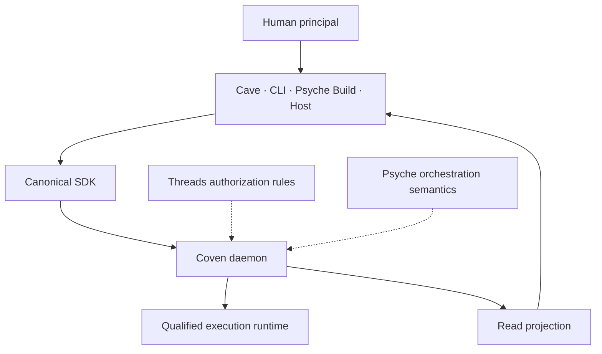

# Architecture and ownership

## Decision and evidence boundary

**Use the Compass Site as a presentation and interaction reference for existing OpenCoven systems. Keep authoritative state transitions in Coven, orchestration meaning in Psyche, and identity governance in the Familiar Contract.** Coven Host should make this work discoverable in a folder and across devices; it should not introduce another daemon, identity root, scheduler, or competing state database. These are the user's architectural requirements, not claims that every production repository already implements them. [U1]

The historical Site baseline is commit `d7b6f1e655140036cca49f31687131352162de13`. The bundle also contains subsequent mobile/navigation work and the [scalable layout/crown refinement](15-scalable-atlas-layout.md), which is implemented and source-level verified. Its README continues to identify the application as a local simulation. Production repositories, their current APIs, and packaged runtime behavior were **not inspected for this handoff**. Treat the integration below as **proposed** until repository discovery establishes the existing contracts and tests. Export provenance identifies the delivered source separately from historical checkpoints. [S1]

Use these labels consistently during implementation:

| Label | Meaning in this handoff |
| --- | --- |
| Source-inspected | A property visible in the bundled Site source. |
| Supplied requirement | A boundary or invariant established by the user's instructions. |
| Proposed | A recommended integration design requiring implementation and review. |
| Discovery required | The corresponding production component, contract, or behavior has not been established. |
| Verified | Reserved for an identified artifact and a recorded acceptance check; never inferred from a mockup. |

## What the bundled Site actually supplies

The Site reduces sample events into browser-side worlds using `apply`, advances or reconstructs them with `seek`, and appends simulation events with `emit`. `canAct` distinguishes live sample interaction from recorded/replay modes. These functions demonstrate interaction behavior; they are not principal authentication, protected authorization, durable scheduling, or a production event log. The `store` helper uses browser local storage for presentation-related persistence. [S2]

| Source surface | Reusable intent | Production boundary |
| --- | --- | --- |
| `atlasSnapshot` in `dist/index.html` | Derive project, familiar, mission, and attention summaries. | Its current objects and fields are local presentation contracts, not canonical SDK schemas. |
| `dist/atlas-ui.js` | Scope navigation, optional project drawer, familiar filtering, keyboard labels. | Clicking a control must not directly commit daemon state. |
| `dist/semantic-map.css` | Show project boundaries, mission seals, familiar glyphs, selected agents, and decision markers. | Visibility and color never grant permissions. |
| `dist/atlas-layout.js`, `dist/atlas-viewport.js`, `dist/atlas-crown.js` | Compact project placement, safe-space fit, bounded detail, and exact canonical crown relief. | Geometry and camera scope are presentation state; routes are not execution dependencies or authority. |
| `sealOf` / `drawSeal` | Quantitative mission representation at three detail levels. | Input measures must come from authoritative evidence, with unknown values explicit. |
| `dist/seal-lab.js` | Explore the renderer's states and measurements in isolation. | Lab settings must remain isolated from operational projects. |
| `tests/presentation.test.cjs` | Source-level regression fixtures with a small DOM facade. | These are not browser, daemon, device, or recovery qualification. |

These distinctions are stated in the README and observable in the referenced implementation. Preserve them when presenting the archive to another agent. [S1] [S2] [S3] [S4] [S5] [S6]

## Canonical ownership

The following ownership map is a **supplied requirement**. “Discover” means locate the current owning code, public contract, and acceptance evidence before adding a feature. It does not authorize creating a new service to fill an apparent gap. [U1]

| Component | Owns or represents | Must not become | Discover before integration |
| --- | --- | --- | --- |
| Familiar Contract | Governed portable familiar identity and revisions. | A display name, color, or folder-derived identity. | Exact root/revision identifiers and session binding checks. |
| SPAR | Continuity profile/query projection across revisions and execution contexts. | Another identity root or standalone competing database. | Existing continuity queries and provenance. |
| Coven Threads | Protected-surface authorization and proposal-versus-commit decisions. | Permission inferred from UI text or model output. | Approval objects, principal authentication, replay/revocation rules. |
| Psyche | Tasks, lanes, leases, attempts, approvals, receipts, retries, and recovery semantics. | A second independent runtime authority. | Canonical state model and how Coven applies it. |
| Coven | Daemon authority, persistence, sessions, execution, and authoritative transitions. | A passive mirror of browser or synced-folder decisions. | Durable storage, transaction boundaries, command/event interfaces. |
| Coven Host | Proposed folder/product arrangement for local and remote work. | Another daemon, scheduler, or control plane. | Existing host registration and workspace lifecycle owners. |
| Projects (drawn by Compass) | Proposed project/workspace scope and its human representation, using Coven's existing project noun. | An invented parallel project schema. | Exact repository, manifest, identifier, and ownership contract. |
| Castles (`OpenCoven/coven-castles`) | A hosted place where a familiar runs work for a Project, such as a bound sandbox. A Project has zero or more Castles (decided 2026-11-19, [D01](11-open-decisions.md)). | Project scope, or an enclosure on the Compass map. | Whether a Castle serves exactly one Project, and its binding to Coven execution. |
| CLI | Human/automation client of the same daemon through canonical bindings. | A privileged bypass with separate state. | Current commands, structured output, errors, and SDK use. |
| SDK | Constrained public clients and canonical bindings. | A second source of orchestration semantics. | Supported versions, adapters, subscription and command methods. |
| Coven Runtimes | Capability descriptors and conformance. | Capabilities asserted by a caller-supplied Boolean. | Runtime identity, attestation/evidence model, qualification gates. |
| Coven Code | Terminal coding execution. | An independent mission database. | Session/attempt binding and cancellation interfaces. |
| Psyche Build | Coding cockpit consuming Psyche canonically. | A separate lane, lease, or approval implementation. | Current worktree, lane, test, and evidence integration. |
| Cave | Human oversight and production UI behavior. | An authorization enforcement boundary. | Production patterns for decisions, stale state, and accessibility. |
| Coven Memory | Read-only memory client/projection. | Another memory authority or writable sync store. | Permitted projections and integrity checks. |
| Coven GitHub | GitHub-triggered familiar delivery. | Authority supplied by issue text or an untrusted webhook body. | Trigger verification, delivery receipts, and protected actions. |
| Brand / UI | Canonical identity/voice; component specimens. | Production state or authorization owners. | Existing tokens, glyphs, accessibility patterns, and component ownership. |

## Proposed data and authority flow

This diagram shows responsibilities, not a proposed set of deployed services. Threads and Psyche may be implemented within existing packages or processes; discover those locations first. The SDK and read projection are constrained client surfaces. [U1]

An authenticated principal requests an operation through a client. Coven resolves the exact familiar root/revision, checks the operation against authoritative authorization and lifecycle state, and commits through the existing canonical transition mechanism. The final authorization check and commit must share the same immutable snapshot or be atomic. A resulting projection makes the outcome visible; it does not retroactively authorize it. [U1]

For integration, maintain a mapping worksheet rather than immediately defining a new wire schema. Establish where the existing contracts provide: project identity; exact familiar binding; mission/task/attempt identifiers; lifecycle state; input and policy revisions; runtime capability evidence; pending decisions; operation outcomes; receipts; and subscription freshness. Missing information remains unavailable until its owner supplies it. Client-generated identifiers may correlate a request but may not establish identity, permissions, or ownership.

## Identity, orchestration, and execution remain distinct

A familiar's glyph and hue help people recognize continuity. They are not the familiar's root, revision, principal binding, or authorization. A delegated worker is an execution participant with a task/attempt relationship; it is not automatically a newly governed familiar. The same familiar can appear in multiple projects without creating multiple identity roots. Bind every executable session to the exact authorized familiar revision through the owning contract. [U1]

Likewise, a “mission” in the Site should map to an existing canonical orchestration object only after its lifecycle and scope match. Do not rename a job, routine, run, or session into a mission merely because both have a title and status. The adapter may compose a display from existing objects while preserving their original identifiers and relationships.

A runtime being able to launch a process does not establish that it can durably cancel, recover, isolate, or account for that process. Qualification evidence must accompany the capability used by the integration. A UI should degrade to an inspectable proposal when the required capability or authoritative evidence is unavailable. [U1]

## Preserve visual meaning without overstating evidence

The source seal has six states: Planned, Active, Needs you, Stalled, Sealed, and Broken. It gives each council familiar a wedge, derives progress from role-owned targets, and uses the rim for the tightest time/token/budget limit. The renderer applies a 12-degree minimum wedge, an eight-wedge ceiling, and a twelve-working-pip cap per familiar. Those display limits must remain visible in exact detail; they must not become limits on the canonical underlying model. [S1] [S2]

The production adapter needs additional **freshness and availability** information alongside lifecycle state. Disconnected, stale, reconciling, rejected, and unavailable cannot honestly be painted Active simply because the last snapshot was active. Keep the six visual states where their meanings fit, and supply a separate factual freshness indicator. Unknown progress must not become zero; absent evidence must not become success.

“Sealed” should mean the defined acceptance criteria have authoritative evidence. The current simulation derives it from modeled target and artifact counters, so it cannot prove a production acceptance result. “Broken” currently follows a limit-paused mission once no open request takes precedence; the Inbox offers “Keep stopped.” Preserve that behavior in the demo, but map production refusal, pause, cancellation, and failure states deliberately instead of collapsing them. [S2]

## Discovery deliverable and decision gate

Before implementation, assign an owner to a compact evidence ledger with one row per integration concern:

1. Record the repository, exact revision, scoped instructions, and public entry point.
2. Identify the authoritative object, storage owner, and transition function.
3. Trace authentication, authorization, revocation, commit, and receipt paths.
4. Record supported snapshot/subscription behavior and its gap/recovery contract.
5. Link tests and packaged/live evidence separately; mark missing checks explicitly.
6. Decide whether the change belongs in an existing SDK adapter, daemon handler, Psyche semantic module, or presentation component.

The gate is a reviewed mapping showing **one owner for each authoritative transition**. If discovery finds overlapping stores or ambiguous ownership, resolve that first. [U1]

Continue with [the integration proposal](03-integration-proposal.md) and [Host folder, sync, and recovery](04-host-folder-sync-and-recovery.md).

## Sources

[U1]: source-context/user-architecture-instructions.md
[S1]: ../../README.md
[S2]: ../../dist/index.html
[S3]: ../../dist/atlas-ui.js
[S4]: ../../dist/semantic-map.css
[S5]: ../../dist/seal-lab.js
[S6]: ../../tests/presentation.test.cjs

- [U1 — supplied architectural and engineering instructions][U1].
- [S1 — Site scope and evidence limitations][S1].
- [S2 — simulation, projection, and seal implementation][S2].
- [S3 — presentation adapter][S3]; [S4 — semantic scene styling][S4].
- [S5 — isolated seal explorer][S5]; [S6 — source-level fixtures][S6].
